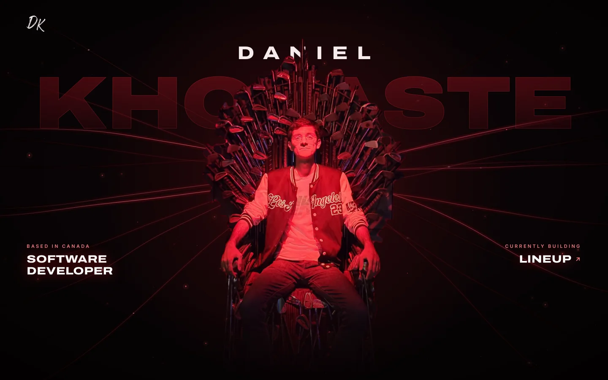

# Daniel's Portfolio

Personal portfolio of Aref "Daniel" Khojaste, software developer. A one-page site built with
[Astro](https://astro.build), [GSAP](https://gsap.com) and DivineFlow, a canvas light-filament
background in [`src/lib/divine-flow`](src/lib/divine-flow).



<p align="center">
  <a href="SCREENSHOTS.md"></a>
</p>

## What's on the page

| Section        | What it shows                                                                     |
| -------------- | --------------------------------------------------------------------------------- |
| **Home**       | The hero: name, role and what I'm building now, over DivineFlow                   |
| **About**      | A short headline, a line about me and three facts                                 |
| **Projects**   | Lineup, Urlocker Consulting, ApotheonAI and ToDone, as rows that open for details |
| **Skills**     | The stack as logos by area, with a filter that lights up the tools a project uses |
| **Background** | Experience and education, as rows that open like Projects                         |
| **Contact**    | What I can build, a contact form that sends straight to my inbox, and my links    |

A side nav on desktop and a full-screen menu on phones and tablets jump between them.

## DivineFlow

DivineFlow draws the hero's light filaments and the underlines in the menu and side nav. It lives in
this repo for now, and it will soon be published as its own npm package.

Copyright © 2026 Daniel Khojaste. All rights reserved. 😎

## Under the hood

- **One config file:** all the copy, animation timings and colours live in
  [`src/site.config.ts`](src/site.config.ts), so the components never need editing for them
- **Contact form:** sends through [Web3Forms](https://web3forms.com). Its access key is in the config
  on purpose: it can only deliver messages to my inbox. Without a key, the form opens the visitor's
  email app instead. What's typed is cleaned, limited and never shown as HTML
- **Security:** a strict Content Security Policy, worked out at build time from the page's own
  scripts, plus a `_headers` file for the host (no framing, no MIME sniffing, HTTPS only)
- **Accessibility:** a skip link, keyboard focus that follows section jumps, closed rows kept out of the
  tab order, and [axe](https://github.com/dequelabs/axe-core) checks in the end-to-end tests
  (WCAG 2.2 AA)
- **Speed:** a [Lighthouse](https://github.com/GoogleChrome/lighthouse-ci) budget in CI:
  performance ≥ 80; accessibility, best practices and SEO ≥ 95
- **Search and sharing:** a share image, Open Graph and Twitter tags, and person data under all three
  names; the icons are drawn from the DK signature at build time

## Requirements

- Node.js 22.23.4 or newer (Astro 7 requirement); `.nvmrc` pins the version CI uses (`nvm use`)

## Scripts

| Command                | What it does                                      |
| ---------------------- | ------------------------------------------------- |
| `npm install`          | Install dependencies                              |
| `npm run dev`          | Start the dev server on `http://localhost:4321`   |
| `npm run build`        | Type-check (`astro check`) and build the site     |
| `npm run preview`      | Serve the production build                        |
| `npm run test:unit`    | Run unit tests (Vitest)                           |
| `npm run test:e2e`     | Build + preview the site and run Playwright tests |
| `npm test`             | Unit tests, then end-to-end tests                 |
| `npm run lighthouse`   | Build the site and run the Lighthouse budget      |
| `npm run format`       | Format everything with Prettier                   |
| `npm run format:check` | Check formatting (used in CI)                     |

First end-to-end run on a new machine: `npx playwright install chromium`.

## Project layout

```
src/
  site.config.ts  the one file to edit: copy, animation timings, colours and DivineFlow options
  assets/         throne photo, DK logo, project screenshots and tool logos
  components/     Header, Menu, SideNav, Hero, About, Work (Projects), Skills, Background, Contact, Footer
  layouts/        BaseLayout (fonts, meta, search data, global styles)
  pages/          the page, plus the icons drawn from the DK signature
  lib/
    divine-flow/  canvas renderer for the light-filament background + unit tests
  scripts/        client scripts (scrolling, rows, skills filter, contact form, icons) + unit tests
  styles/         global tokens and resets
integrations/     security-headers.mjs: the CSP and the _headers file, at build time
public/           share image, robots.txt
tests/e2e/        Playwright specs (desktop and mobile, including accessibility and security)
screenshots/      images for the README and SCREENSHOTS.md
wrangler.jsonc    Cloudflare Workers settings for hosting
```

## Hosting

The site is static. [Cloudflare Workers](https://developers.cloudflare.com/workers/static-assets/)
builds it from `main` with `npm run build` and serves `dist/` with `npx wrangler deploy`, which reads
[`wrangler.jsonc`](wrangler.jsonc). The security headers come from `dist/_headers`.

See [CHANGELOG.md](CHANGELOG.md) for what changed and when.
