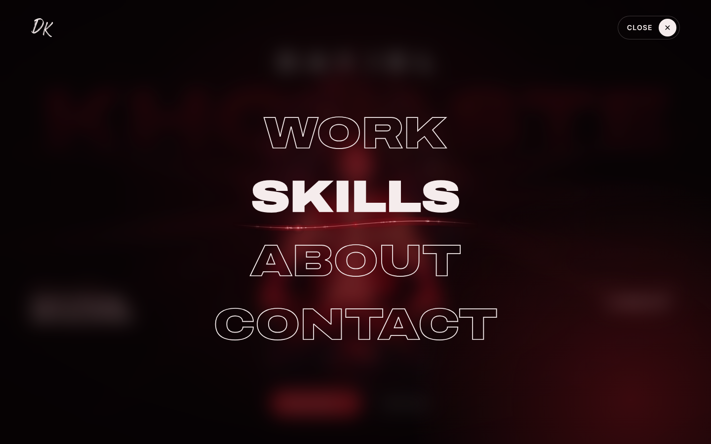
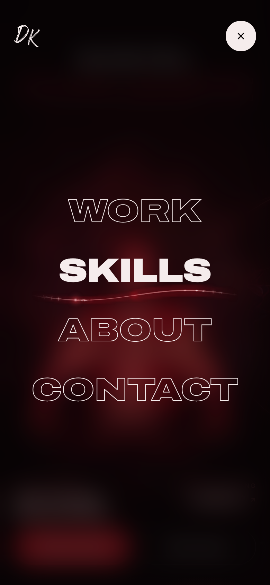

# Screenshots

[← Back to the README](../README.md)

## Desktop

1440 × 900.

**Home**

**Menu**, with the DivineFlow underline under Skills

## Tablet

820 × 1180 (portrait).

**Home**

## Phone

390 × 844.

<table>
  <tr>
    <th>Home</th>
    <th>Menu (Skills focused)</th>
  </tr>
  <tr>
    <td></td>
    <td></td>
  </tr>
</table>
